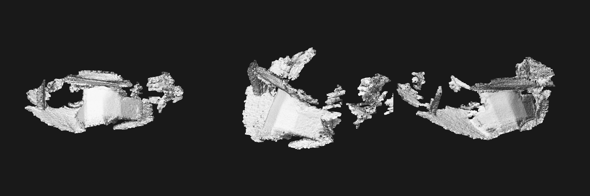

# Lucy as a 3D scanner (experiment)

Can a robot vacuum's depth camera make a printable 3D scan? This is hand-carried or stationary only, with the object turning. Scanning while she drives herself was ruled out. The aim is good geometry over pretty colour, ending in a 3D print.

**Status:** feasibility work only. One rough mesh so far.

*The first mesh: 204 frames of a folded card box, one side only, aligned by ICP alone.*

## What was measured

| Thing | Result |
|-------|--------|
| ToF resolution | 224x172 |
| Frame rate | 5 Hz on the dock, about 7 Hz while moving, 2.5 Hz in an earlier capture |
| Frame-to-frame noise | about 2 mm at 0.3-0.6 m, 3 mm at 0.6-1 m, 9 mm at 2-4 m |
| Range seen | up to 3.8 m |
| Near limit | touching a wall read a median of 2.3 cm, 96% valid |

Noise isn't accuracy. The close wall reading sits about 6 mm off a best-fit plane, so close-range warping still needs testing against a flat sheet at known distances.

## Colour

The factory calibration in `/data/user/app/calib/calib_lucy.json` has the camera intrinsics, distortion and `rgb_T_depth` (baseline 1.2 cm). Using it, the point cloud lines up with the colour image by eye. RGB goes soft at very close range.

## Pose

Every depth frame carries a pose5d: x, y, yaw, roll and pitch.

- Angles are in radians, and yaw is cumulative and unwrapped.
- Compared with ICP on real frames, yaw tracks rotation (correlation 0.94) and pitch tracks nodding (0.95), so orientation still works off the floor.
- Yaw drift on the dock is near constant at about 0.001 rad/s. Measure it for 10 s before a scan and subtract it.
- `/data/local/tmp/txen_driver-bot_data` (PUB) gives the same values at 100 Hz.
- Raw gyro and accelerometer data haven't been found. `txen_driver-imu_data` stayed silent.

## Recording without the server

The server isn't needed once a recording has started, or to start one locally. `server/onrobot/scanrec.sh <name> <secs> [rgb_every]` sends the wake signal described in [camera_audio.md](camera_audio.md), and writes depth, angles and stills to `/data/lucy_local/scans/<name>/`. It stops if free space falls under 400 MB. Start it with `nohup` so it outlives the SSH session.

With the server off, a 120 s test on the dock got 601 depth frames with a longest gap of 0.2 s. That used about 90 MB per minute with a still every 5 s.

Lifting her doesn't stop the depth feed. Her status reads "scanning" (20) while lifted, and she logs `WHEEL_NOT_ON_SURFACE` and NeedReloc. Map files weren't touched.

## Triggers (not built)

- **Home button:** seen cleanly on the dock in the status socket, as `BUTTON_2 PRESS_1_S`, with no mode change. What it does off the dock is untested.
- **Bumper:** no digital signal while idle. Taps do show up as jolts in the angle feed.
- **Lens cap (preferred plan):** start when the cap comes off, stop when it goes back on. Not yet tested.

## Tools

In `server/tools/`:

- `scan3d_capture.py`: record
- `scan3d_read.py`: summarise
- `scan3d_close.py`: flatness by distance
- `scan3d_fuse.py`: ICP alignment and TSDF fusion with Open3D (Linux/WSL)

On the robot: `server/onrobot/depthdump.c` and `scanrec.sh`.

## Next

- A real object all the way round on a turntable.
- A stiff flat sheet at known distances, to measure close-range accuracy.
- A printed ArUco ring around the object, for per-frame pose from RGB.
